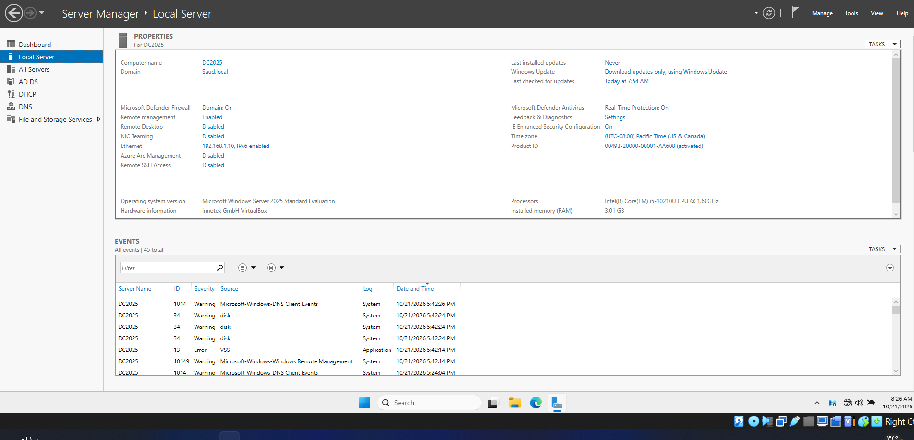
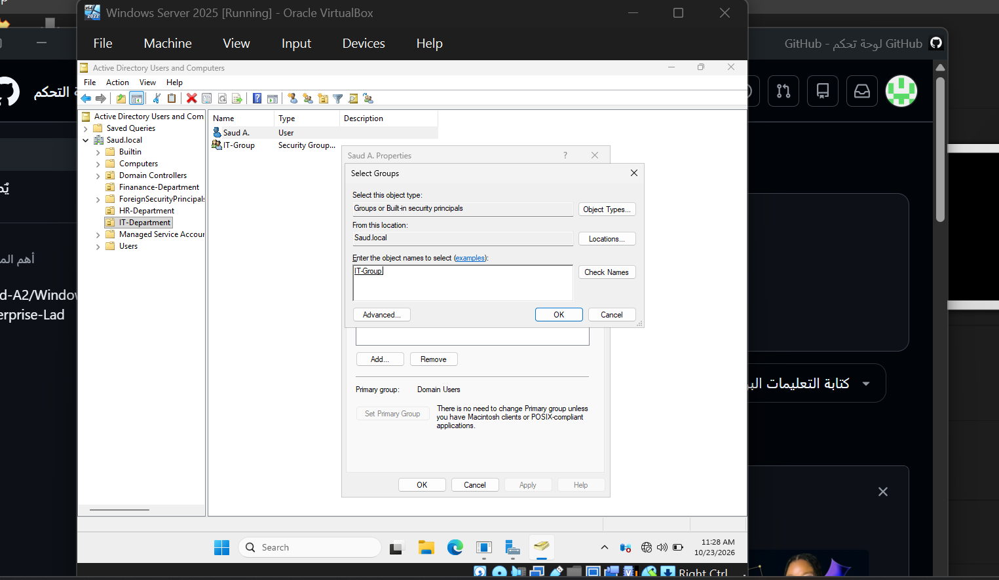
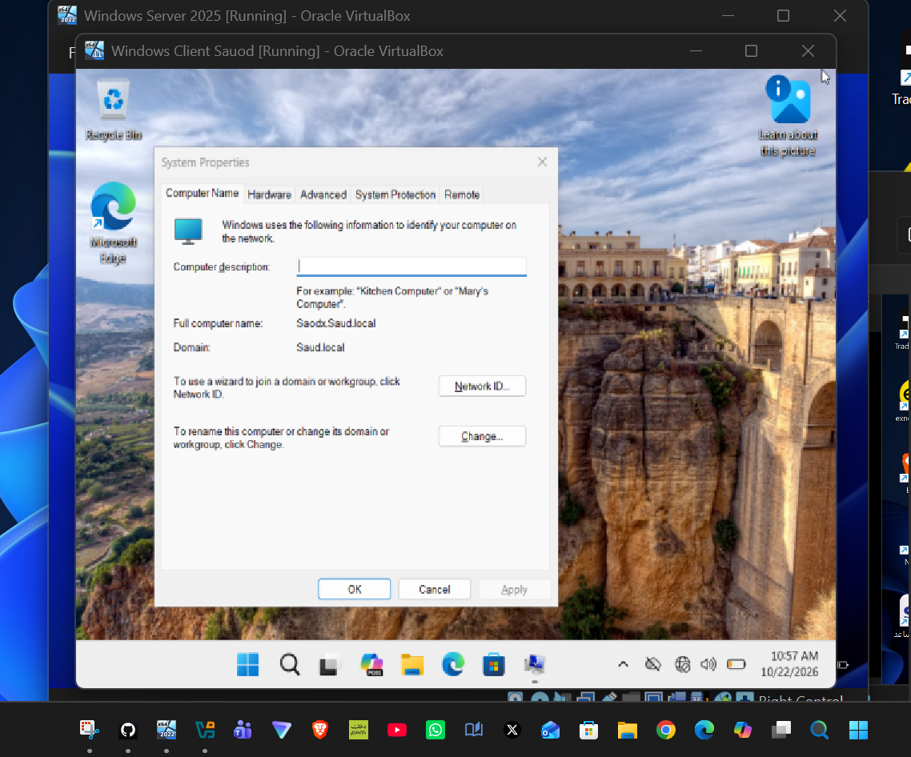
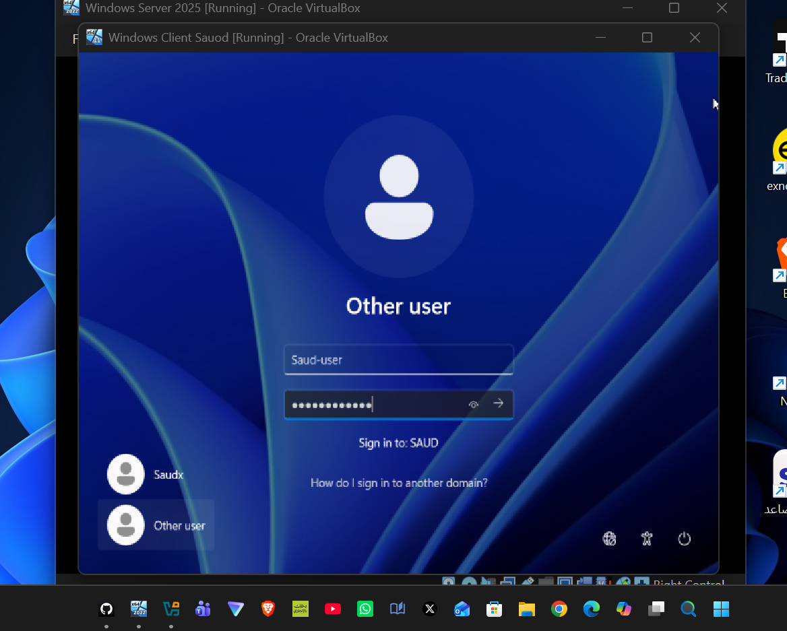
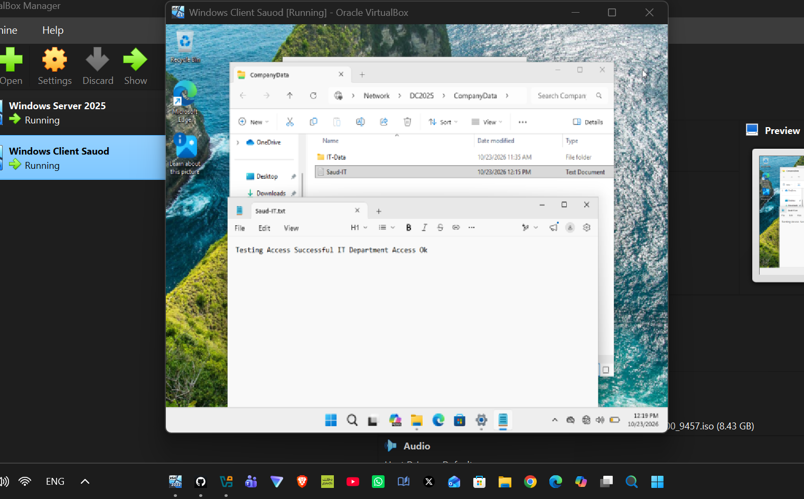

# 🚀 Windows Server 2025 Enterprise Infrastructure, AD DS & File Sharing Lab

A comprehensive hands-on implementation guide and technical documentation for setting up a full-stack Windows Server 2025 Enterprise environment. This repository demonstrates end-to-end configuration including VirtualBox internal networking, Active Directory Domain Services (AD DS), Organizational Unit (OU) structure, client domain join, Kerberos authentication, and granular SMB Share & NTFS permission management following the Principle of Least Privilege (PoLP).

---

## 📌 Project Overview
This project provides an industry-standard portfolio entry showcasing practical system administration skills. It details the complete setup lifecycle—from initial hypervisor network isolation and core domain controller promotion to domain user logon validation and hybrid network file share security testing.

---

## 🛠️ Lab Infrastructure & Technical Specifications
| Component | Details |
| :--- | :--- |
| **Virtualization Platform** | Oracle VirtualBox |
| **Domain Controller (DC)** | Windows Server 2025 Enterprise (`DC2025.saud.local`) |
| **Client Workstation** | Windows 11 Enterprise (`Saud A.`) |
| **Static IP Address** | `192.168.10.10/24` (Primary DNS: `192.168.10.10`) |
| **Active Directory Domain** | `saud.local` |
| **Security Group** | `IT-Group` |
| **Network Share UNC Path** | `\\DC2025\CompanyData\IT-Data` |

---

## 📋 Comprehensive Implementation & Verification Stages

### Stage 1: Virtualization Infrastructure & Internal Network Setup

* **Technical Details:**
  * Provisioned isolated virtual machine nodes for Windows Server 2025 and Windows 11 Enterprise using Oracle VirtualBox.
  * Configured dedicated **Internal Network** adapters on both virtual machines to guarantee secure, isolated host-to-guest and inter-VM communication.

---

### Stage 2: Core Server Baseline & Static IP Binding

* **Technical Details:**
  * Configured local server identity properties by setting the hostname to `DC2025`.
  * Assigned a static IPv4 address (`192.168.10.10/24`) and configured the primary DNS pointer to route local directory queries correctly.

---

### Stage 3: Active Directory Domain Services (AD DS) & OU Hierarchy

* **Technical Details:**
  * Installed AD DS role and promoted `DC2025` as the forest root Domain Controller for `saud.local`.
  * Structured Active Directory by creating Organizational Units (OUs) for enterprise departments, provisioning user accounts (`Saud A.`), and managing domain security.

---

### Stage 4: Role-Based Access Control & Security Group Membership

* **Technical Details:**
  * Created the `IT-Group` security group to enforce Role-Based Access Control (RBAC).
  * Assigned domain user `Saud A.` to `IT-Group` to streamline permission assignment across shared domain resources.

---

### Stage 5: Domain Join & DNS Resolver Verification

* **Technical Details:**
  * Configured client DNS settings to point to `192.168.10.10`.
  * Executed domain join operation on the Windows 11 client machine, binding it securely to `saud.local` and validating active Domain Controller connectivity.

---

### Stage 6: Domain Identity Authentication & Session Logon

* **Technical Details:**
  * Validated domain identity authentication through the Windows Interactive Logon screen on the client machine using domain credentials (`saud.local\Saud-user` / `Saud A.`).
  * Confirmed Kerberos/NTLM authentication ticket generation and session initialization.

---

### Stage 7: Hybrid File Share, NTFS Security & Live Access Validation

* **Technical Details:**
  1. Configured SMB Advanced Sharing on directory `C:\CompanyData` with Share Permissions set to `Everyone: Full Control`.
  2. Applied strict **NTFS Security Permissions** on sub-folder `IT-Data` by disabling permission inheritance and granting `Modify / Read / Write` rights exclusively to `IT-Group`.
  3. Accessed shared resource via UNC path `\\DC2025\CompanyData\IT-Data` from the Windows 11 workstation as user `Saud A.`.
  4. Created and modified `Saud-IT.txt` with verification payload: `Testing Access Successful IT Department Access Ok`.
  5. Saved changes successfully without permission errors (`Access Denied`), validating 100% operational success for hybrid SMB and NTFS access rules.

---

## 👤 Author
* **Saud Al-Ziyadi**
* IT Computer Technical Support Specialist
