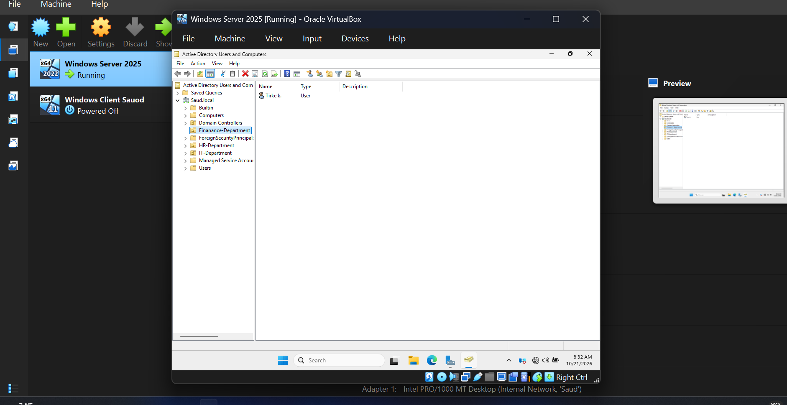
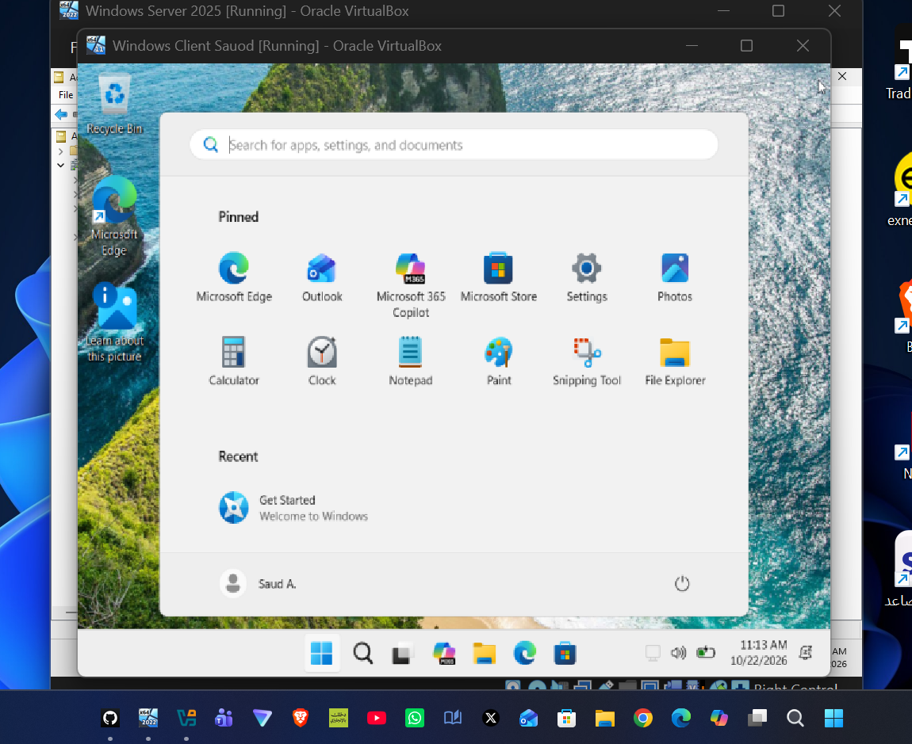

# Windows Server 2025 Enterprise Lab Setup & Domain Join

## 📌 Project Overview
This repository documents the end-to-end setup and configuration of an enterprise-grade Virtual Machine environment using **Oracle VirtualBox**. The lab demonstrates full infrastructure setup including active directory domain service installation, domain controller promotion, network interface configuration, client domain joining, and domain user authentication testing.

---

## 🛠️ Lab Environment & Components
* **Virtualization:** Oracle VM VirtualBox
* **Domain Controller (DC):** Windows Server 2025 (`DC2025`)
* **Client Workstation:** Windows 11 Enterprise (`Windows Client Saud`)
* **Domain Name:** `saud.local`
* **Static IP Address:** `192.168.10.10/24`

---

## 🚀 Phases & Documentation

### Phase 1: VirtualBox Environment Setup
* Created dedicated virtual machines for Windows Server 2025 and Windows 11 Client.
* Configured Internal Network adapter settings to allow secure inter-VM communication.

---

### Phase 2: Core Server & Network Configuration
* Renamed server hostname to `DC2025`.
* Configured static IP configuration (`192.168.10.10/24`) and DNS server settings.

---

### Phase 3: Active Directory Domain Services & Organizational Units
* Installed Active Directory Domain Services (AD DS) role.
* Promoted server to Domain Controller for new forest `saud.local`.
* Created Organizational Unit (OU) structure and domain user accounts (`Saud-IT`).

---

### Phase 4: Client Domain Join Verification
* Configured Windows 11 client DNS settings pointing to `192.168.10.10`.
* Joined the Windows 11 client machine to `saud.local` domain successfully.

---

### Phase 5: Domain User Logon & Authentication Verification
* Verified Active Directory domain login using created domain user credentials (`Saud-IT`).
* Authenticated successfully on the client machine against the domain controller.

---

## 👤 Author
* **Saud Al-Ziyadi**
* Computer Technical Support Specialist
