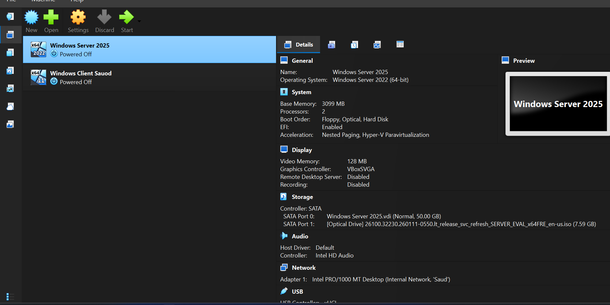

# 🖥️ Enterprise Infrastructure Lab: Windows Server 2025 & Active Directory

---

## 📌 1. Executive Summary / الملخص التنفيذي

**English:**  
This repository details the end-to-end deployment, configuration, and management of a virtualized enterprise IT infrastructure. The setup features a **Windows Server 2025** Primary Domain Controller (DC) providing core network identity and services (AD DS, DNS, DHCP, GPO) and a **Windows 11 Pro** client endpoint joined to the domain.

**عربي:**  
يوثق هذا المستودع خطوات إنشاء وتكوين وإدارة البنية التحتية الافتراضية الكاملة لشبكات الشركات. يتضمن المختبر خادم **Windows Server 2025** كـ (Primary Domain Controller) لإدارة الهوية والخدمات الأساسية، بالإضافة إلى جهاز عميل **Windows 11 Pro** منضم للمجال.

---

## 🛠️ 2. Environment Architecture / معماريّة البيئة الوهمية

* **Host Machine:** Lenovo ThinkPad T14 (Windows 11 Home)
* **Hypervisor:** Oracle VirtualBox
* **Internal Network:** `LabNet` (Isolated Virtual Network)

### 🖥️ Virtual Machines Specifications

| Machine Name | Role | OS Version | IP Address | Subnet Mask | Preferred DNS |
| :--- | :--- | :--- | :--- | :--- | :--- |
| **`DC2025`** | Primary Domain Controller | Windows Server 2025 | `192.168.10.10` | `255.255.255.0` | `127.0.0.1` |
| **`CL01-Saud`** | Domain Client Endpoint | Windows 11 Pro | DHCP (`192.168.10.50+`) | `255.255.255.0` | `192.168.10.10` |

---

## 📸 3. Implementation Phases & Proof of Concept / مراحل التنفيذ والتوثيق

### Phase 1: Lab Virtualization & Base Installation / مرحلة بناء البيئة الوهمية
* Configured VirtualBox Internal Network (`LabNet`) to isolate traffic.
* Installed Windows Server 2025 (Desktop Experience) on `DC2025`.
* Configured Guest Additions for full-screen integration.

---

### Phase 2: Core Server & Network Configuration / إعدادات السيرفر والشبكة
* Renamed server hostname to `DC2025`.
* Configured static IP configuration (`192.168.10.10/24`).

---

### Phase 3: Active Directory Domain Services & OUs / إعداد الدومين والـ OUs
* Promoted server to Domain Controller for new forest **`saud.local`**.
* Created Organizational Unit (OU) structure: `SAUD-HQ` -> `IT`, `HR`, `Finance`.

---

## 👤 Author / منفذ المشروع

**Saud Al-Ziyadi**  
*Computer Technical Support Specialist*
